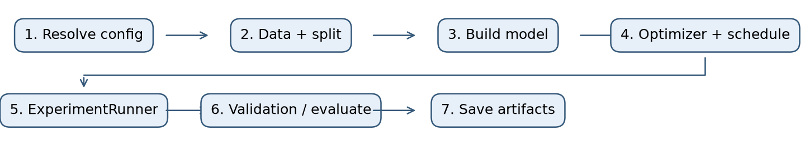
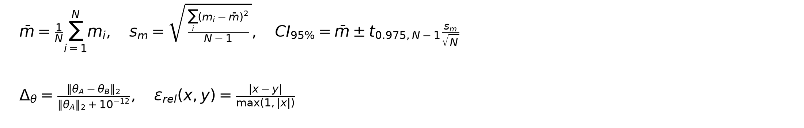
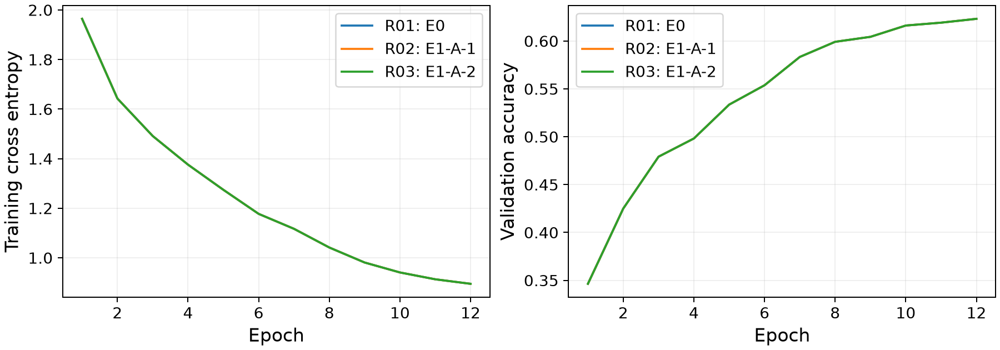
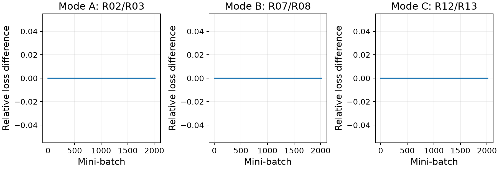
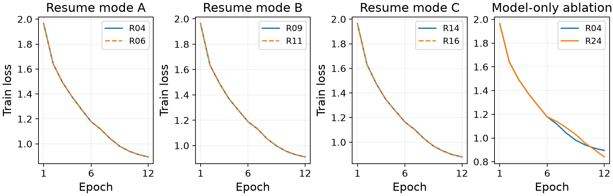
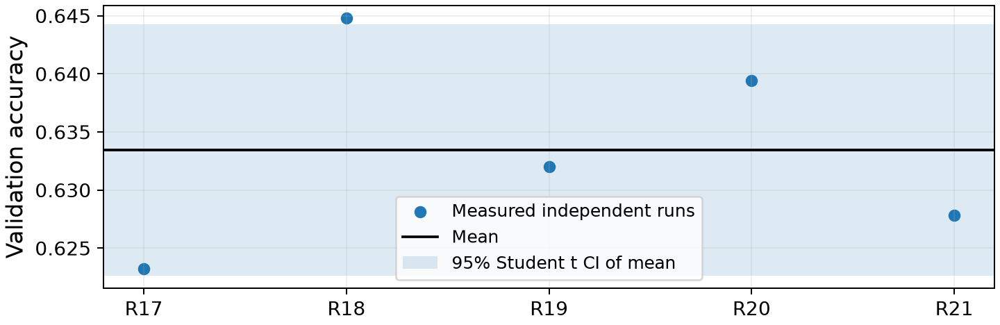
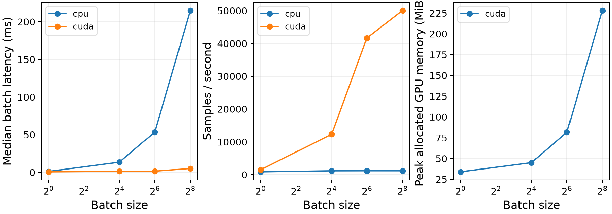

# Лабораторная работа 0. Инфраструктура воспроизводимых экспериментов

Автор: Ван Чжаофу. Курс «Нейронные сети». Отчёт построен из сохранённых журналов; обозначения Rxx однозначно раскрываются в реестре RUN_ID в конце документа.

Основание требований: lab0_experiment_harness_1010.pdf, редакция 2.1 от 09.10.2026. Структура из шести разделов соответствует §28 исходного задания.

## 1. Профиль и конфигурация

Профиль `P3adf02`, хеш идентификатора `3adf0221499eacfc4e28050e33c8f0c4118d71ff1f3b161c5c9524754e2a36f9`. Исходный идентификатор не публикуется. Использованы CIFAR-10, доля train 0.25, ширина CNN 96, глубина 4, batch size 64, AdamW, начальная скорость 0.001, weight decay 0.0001, cosine schedule с одной эпохой прогрева. В окончательной программе K=12, CPU threads=2. Число параметров 252778 (R01).

Модель: 4 слоёв Conv2d 3×3 со stride=1, padding=1 и bias, после каждого ReLU; после первых 3 свёрток MaxPool2d 2×2. Все скрытые каналы равны 96. Затем global average pooling, flatten и Linear 96→10. BatchNorm, dropout и аугментации отсутствуют.

Из официальных 50000 обучающих изображений выделены train=43000, val=5000, cal=2000; test=10000 сохраняется отдельно. Для ЛР0 используется 10750 изображений train. Разбиение стратифицировано, seed=1729; доля применяется только к train. Нормализация рассчитана только по train; cal и test не использовались для обучения или подбора. Учебный файл протокола отсутствует, поэтому нельзя утверждать совпадение индексов с файлом преподавателя. Хеш разбиения `1fb3cce79756298949821689d00533bb092604dd2d41a3d687de0fd02bf83574` (R01).

Окружение: Python 3.11.17, PyTorch 2.7.1+cu126, CUDA 12.6, cuDNN 90701. GPU: RTX 3060 Laptop 6 GB. Режим A: CPU/deterministic/без AMP/workers=0; B: CUDA/deterministic/без AMP; C: CUDA с AMP. Workers=2 отдельно обозначен как вмешательство режима C, хотя таблица §12.1 включает эти прогоны в общий CPU-бюджет.

Начальная попытка K=10 не прошла условие уменьшения loss вдвое: 1.9642590621→0.9827822588, отношение 0.500332. RUN_ID `187f3bd4a93cd598f53b-47b8eee4daa145949b8406914abff222` сохранён и не объявлен успешным. После проверки журналов выбрана проверяемая коррекция — K=12 с полным переобучением; профиль и исходные данные не изменены. Это изменение длительности, а не продолжение старой cosine-траектории. Измеренная стоимость эпохи около 24 s, оценка 13·12·24≈3744 s без дополнительных CUDA-проверок; фактическое время основного serial-suite (без ранее выполненного E0 и последующих дополнительных CF4/profiling) 65.05 min. Бюджетный RUN_ID `e592bd6f1f2da6e9f959-f1f208b3b6844b71a89d774e5e291a44`. Бюджетные прогоны не считаются E0. Тестируемый commit основной серии `5abedb11663b56690456dca8e8fa3dba24fbb3a7`.

## 2. Устройство harness

Семь стадий: resolved config → данные и split → модель → optimizer/scheduler → ExperimentRunner → validation/evaluation → артефакты. Общие модули используются всеми условиями. Параметры находятся в YAML, переопределения сохраняются в resolved config.

EXP_ID — первые 20 шестнадцатеричных символов SHA256 канонического описания commit/dirty/source hash, resolved config, data/split fingerprint и seed. RUN_ID дополняет EXP_ID независимым UUID. Окружение отдельно записывается в manifest. Изменение результатов не меняет статус исходного кода: область проверки Git явно ограничена src/tests/scripts/configs/pyproject. Между парными прогонами код не коммитировался. Для грязных разработческих прогонов дополнительно сохраняется снимок исходников.

Manifest содержит оба ID, дату, профиль и student hash, Git commit/dirty/source hash, config/data/split hashes, режим, версии, lock hash, устройство, параметры и путь к resolved config. Малые текстовые результаты и split входят в Git; datasets/checkpoints/plots исключены. Без checkpoint теряются точное состояние оптимизатора и возможность немедленного продолжения; воспроизведение потребует повторного обучения.

Checkpoint содержит model, optimizer, scheduler, epoch, фактический global step, Python/NumPy/Torch/CUDA RNG, generator DataLoader, AMP GradScaler. Восстановление поддерживается на границе полной эпохи. Новый процесс создаёт новый RUN_ID и указывает родительский RUN_ID. При AMP пропущенное из-за overflow обновление не считается шагом оптимизатора. Неравные микробатчи при накоплении взвешиваются по числу объектов.

Логи хранят loss, accuracy, lr, epoch/step/time; отдельно сохраняется loss каждого mini-batch. Профилирование использует синхронизацию CUDA до и после интервала, не менее 50 прогревов и 100 измерений на batch size. Все числа ниже рассчитаны из этих файлов.

Проверка выпуска: 25 автоматических тестов; failures=0, errors=0, skipped=0, 20.400 s (tests-lab0-release.xml). Тесты обучения используют маркированные synthetic fixtures и не заменяют реальные эксперименты ниже.

## 3. Результаты E0–E4

E0 (R01): train loss 1.964259→0.895176; отношение 0.455732; validation accuracy 0.6232. Независимый evaluate воспроизвёл итоговую accuracy. Условия приёмки: PASS.

E1 и E3:

| Режим | E1 runs | max εrel(loss) | Δaccuracy | E1 | E3 runs | Δθ | E3 |
|---|---|---:|---:|---|---|---:|---|
| A | R02/R03 | 0 | 0 | PASS | R04/R06 | 0 | PASS |
| B | R07/R08 | 0 | 0 | PASS | R09/R11 | 0 | PASS |
| C | R12/R13 | 0 | 0 | PASS | R14/R16 | 0 | PASS |

В A требуются точные траектории и метрика, Δθ≤1e-7; в B — εrel(loss)≤1e-5, Δaccuracy≤.001 и Δθ≤1e-5. В C численные пороги не заданы: таблица сообщает измерение, а не универсальную гарантию. Во всех режимах проверены split, first-batch checksum и число реальных обновлений. A: continuous/resume=2016/2016, пропущено из-за overflow=0; B: continuous/resume=2016/2016, пропущено из-за overflow=0; C: continuous/resume=2015/2015, пропущено из-за overflow=1.

E2 (R17, R18, R19, R20, R21): N=5, средняя validation accuracy=0.633440, выборочное стандартное отклонение=0.008708, 95% Student t CI=[0.622628; 0.644252]. Все пять seeds различны; split и остальные условия фиксированы. Ориентир PDF для минимального эффекта — 2s=0.017416. Разброс не превышает 1.5 п.п.

E4: источник обученных весов — R02; raw samples находятся в E4-cpu-registered.json/E4-cuda-registered.json серии; исходные замеры E4-cpu.json/E4-cuda.json также сохранены. Forward-only latency отличается от времени training step; длительность эпох берётся из training logs, а не выводится из forward throughput.

Отдельный E4 RUN_ID для cpu: `c29fec693e78f31bd03b-2afa25ee666d4ce4823bf95d43f5c1a8`; источник весов `6a750eb4531ac754cde7-b798991a1a7b457cbb0de2144b2a4742`. Измерений на B: 100; прогревов не менее 50. Входы — явно заданные тензоры нормального распределения формы B×3×32×32; это замеры времени, не оценка accuracy.

### E4, cpu

| B | mean ms | median ms | p95 ms | samples/s | CV | peak GPU MiB |
|---:|---:|---:|---:|---:|---:|---:|
| 1 | 1.1572 | 1.1524 | 1.1914 | 864.12 | 0.0163 | n/a |
| 16 | 13.6443 | 13.5893 | 14.2845 | 1172.65 | 0.0219 | n/a |
| 64 | 53.6907 | 53.5572 | 54.7072 | 1192.01 | 0.0101 | n/a |
| 256 | 215.7320 | 214.8388 | 219.6980 | 1186.66 | 0.0158 | n/a |

CV>10% при B=[]. Число повторов увеличено по сравнению с исходными 30 до 100; все замеры сохранены. Порог CV соблюдён для всех B.

Отдельный E4 RUN_ID для cuda: `724bae602e86195355ad-dbf545e3a7da421e9daf3626733fb95d`; источник весов `6a750eb4531ac754cde7-b798991a1a7b457cbb0de2144b2a4742`. Измерений на B: 100; прогревов не менее 50. Входы — явно заданные тензоры нормального распределения формы B×3×32×32; это замеры времени, не оценка accuracy.

### E4, cuda

| B | mean ms | median ms | p95 ms | samples/s | CV | peak GPU MiB |
|---:|---:|---:|---:|---:|---:|---:|
| 1 | 0.6578 | 0.6619 | 0.6797 | 1520.19 | 0.0236 | 34.04 |
| 16 | 1.2995 | 1.2944 | 1.3372 | 12312.81 | 0.0191 | 45.15 |
| 64 | 1.5343 | 1.5352 | 1.5776 | 41711.69 | 0.0381 | 81.72 |
| 256 | 5.1167 | 5.1001 | 5.1928 | 50032.69 | 0.0173 | 227.97 |

CV>10% при B=[]. Число повторов увеличено по сравнению с исходными 30 до 100; все замеры сохранены. Порог CV соблюдён для всех B.

Время полной эпохи (обучение и validation), фактические журналы E1:

| Режим / run | mean epoch s | p95 epoch s | peak training GPU MiB |
|---|---:|---:|---:|
| A / R02 | 23.453 | 24.392 | 0.00 |
| B / R07 | 2.227 | 2.366 | 150.87 |
| C / R12 | 2.521 | 2.764 | 116.38 |

Дополнительная проверка устойчивости GPU timing: RUN_ID `efe887782e2794dfe859-e0ce03d1443a4128b6f5749b42fcc1fb`, измеренный прогрев не менее секунды на каждом B, затем 50 дополнительных warmup и 300 измерений. Она не заменяет предписанную серию выше; все три серии сохранены.

| B | initial mean ms / N100 | registered mean ms / N100 | extra mean ms / N300 | extra CV | SM MHz before→after |
|---:|---:|---:|---:|---:|---|
| 1 | 0.6639 | 0.6578 | 0.6559 | 0.2081 | 1425→1425 |
| 16 | 0.6810 | 1.2995 | 1.2208 | 0.1362 | 1425→1620 |
| 64 | 1.4781 | 1.5343 | 1.4594 | 0.0301 | 1620→1710 |
| 256 | 5.1531 | 5.1167 | 5.1799 | 0.0239 | 1717→1575 |

В дополнительной серии порог CV не достигнут при B=[1, 16]. Увеличение N до 300 и дополнительный прогрев не устранили вариативность. Для B16 наблюдалось изменение частоты SM, но по этим данным нельзя приписать все выбросы частоте или полностью разделить GPU clock variation и задержки запуска на host. Поэтому устойчивость latency вне конкретной серии не установлена; цифры для малых B имеют это ограничение. Сырые выбросы не исключались.

## 4. Уровни воспроизводимости

Для режима A измеренная серия подтверждает R3 (наблюдаемое совпадение серии) в зафиксированном окружении. 

Для режима B измеренная серия подтверждает R3 (наблюдаемое совпадение серии) в зафиксированном окружении. 

Для режима C измеренная серия подтверждает R3 (наблюдаемое совпадение серии) в зафиксированном окружении. В C наблюдаемое совпадение объясняется фиксированными seed, потоком данных, алгоритмами и одним устройством; AMP сам по себе не вводит случайность. Это не обещание побитовой повторяемости для любых AMP/worker условий.

## 5. Контрфактические вопросы

1. По E2 среднее=0.633440, s=0.008708, ориентир 2s=0.017416 (R17, R18, R19, R20, R21). Это эвристика PDF, не рассчитанная мощность теста. При допущении независимых одинаково распределённых прогонов стандартная ошибка среднего убывает как N^(-1/2), поэтому для вдвое меньшего эффекта при фиксированных квантилях требуется примерно 4N=20 прогонов. Дополнительные 15 запусков означают около 72 min сверх принятой оценки всей серии около 62 min; без пересмотра исходного бюджета это не укладывается. При ~24s/epoch и K=12 это около 96 min только на одну серию, без CUDA и диагностики. Точное число для заданной мощности требует заранее выбранного теста/альтернативы; из пяти измерений универсальную гарантию получить нельзя.

2. Два запуска workers=2: R22/R23; max εrel(loss)=0, Δaccuracy=0. При сопоставлении с workers=0 (R02) split, checksum первого batch и все 2016 step losses совпали; Δaccuracy=0. В текущем pipeline отсутствуют случайные аугментации, порядок задаётся отдельным generator, workers получают фиксированные seed. Число workers изменяет выполнение загрузки, но в измеренной серии не изменило входные данные и арифметику модели; это объясняет отсутствие расхождения. Наблюдение не распространяется на произвольные аугментации и другие pipelines.

3. Усечённый checkpoint содержит только model.state_dict; итог R24 против R04: Δθ=0.37102801. Для локализации выполнен отдельный опыт RUN_ID `699083a5d60b457b7a27-4565dcc8697040c498b47d8fedaae4d4`: одна и та же сохранённая точка и один и тот же градиент (loss=1.2374443). Сброс только моментов AdamW при прежней lr дал Δθ=0.00982349; изменение только lr с 0.00057115742 на 0.001 при сохранённых моментах дало Δθ=0.0015197029. Без generator state порядок следующего batch меняется: да. Loss контрольного batch совпал с реально записанным первым шагом эпохи 7. Таким образом, потеря моментов, положения schedule и порядка данных даёт независимо проверяемые источники расхождения. Локальные одношаговые разности нельзя складывать как разложение конечного Δθ. Для данного CNN нет dropout и случайных аугментаций; Python/NumPy/global Torch RNG сохранены для общего интерфейса, их отдельное влияние здесь не измерялось.

4. В исходной E2 из пяти seeds пары с |Δaccuracy|<.001 не оказалось. Число дополнительных запусков по тому же протоколу: 3; дополнительный бюджет был заранее ограничен. Проверенные пары: R25/R27: accuracy=0.6364/0.6364, |Δaccuracy|=0.000000, совпадение всех step losses — нет, max εrel(loss)=0.510981, различных step losses=2016. Основные mean/s/CI выше по-прежнему рассчитаны только по исходным пяти seeds. Близкая конечная accuracy не доказывает воспроизведение траектории; дополнительный поиск пары не является оценкой эффекта нового метода.

5. В manifest R02 сохранён cuDNN=90701. При замене версии изменится environment.cudnn, но не каноническая функция EXP_ID, если код/config/data/seed прежние. Фактическая замена библиотеки не выполнялась. Происхождение R0 остаётся описываемым, R1 для сохранённого split можно проверить; R2/R3 после изменения окружения без повторных измерений не гарантируются.

6. Выполнены два состояния отдельной sandbox-копии data_batch_1 по одному и тому же имени и пути, размер не изменился. Диагностические RUN_ID `86c8dd0011a17e664ca2-d4864d8b3e2446ebbd586261f081c1b9` и `26fbdb25ae58f6ba17cc-acc3b6459ddd475885825852351b1aa8`. SHA256 до изменения=54636561a3ce25bd3e19253c6b0d8538147b0ae398331ac4a2d86c6d987368cd, после изменения одного байта=8b0686ccaea34977c1f2443df1f75e662d8dd988fc1137c8050051f687b987e7. Изменились data fingerprint и EXP_ID; config hash, split fingerprint, seed, Git commit, source hash и профиль остались прежними. У независимых диагностических запусков различаются RUN_ID. Официальные обучающие файлы не изменялись. MD5-проверка CIFAR дополнительно отклонила бы испорченный файл до обучения.

7. Для B=1 CPU first forward=3.3674 ms, median после прогрева=1.1524 ms, отношение=2.922 (R02 / E4-cpu-registered.json). Увеличение первого интервала согласуется с ленивой подготовкой вычислений и памяти; без отдельной трассировки разделить эти составляющие нельзя.

8. Минимальная CPU median latency при B=1: 1.1524 ms. Максимальный throughput при B=64: 1192.01 samples/s (R02 / E4-cpu-registered.json). Batch latency и стоимость одного изображения различны; больший batch распределяет накладные расходы по большему числу объектов, пока не насыщается вычислитель. Это эмпирический максимум данной серии; превосходство соседних B отдельным статистическим тестом не установлено.

## 6. Ограничения

Нельзя переносить результат на другую версию PyTorch/CUDA/cuDNN, устройство или недетерминированный pipeline без повторной проверки. Восстановление внутри произвольного mini-batch не реализовано. CPU temperature не измерялась; пользователь просил не задерживать работу из-за отсутствия датчика. Официальная страница CIFAR не указывает отдельную лицензию; исходные изображения не распространяются в репозитории. Учебный протокол и стандартный файл split отсутствуют. Для C совпадение не является универсальной гарантией. Вариативность GPU timing при CV>10% остаётся ограничением; данные не сглаживались и не заменялись. Дополнительные seeds CF4 служат только контрпримером: адаптивно найденная пара не заменяет исходную серию E2.

PDF экспортирован из общего текста через ReportLab 4.4.9 с встроенными кириллическими шрифтами. Полный LaTeX-источник сохранён; его компиляция не проверена: процесс встроенного компилятора не запускается, ошибка 1060.

После основной серии неизменные численности val/cal вынесены в YAML, добавлен табличный вывод compare. Исторические manifest не переписаны. Проверка выпуска отдельно сравнивает данные и первый реальный epoch; полная серия относится к указанному выше исходному commit.

Проверка выпуска: RUN_ID `051d566d9b717bf5a619-3ce892edf95844a6acc846f36a9f7f92`, commit `02bd8b9fac5aa28f69813b7adb512563edfb91fd`, статус PASS. Data/split/subset fingerprints, нормализация и checksum совпали; loss первого реального epoch=1.9642590621, val accuracy=0.3464, обе величины точно совпали с первым epoch исходной серии. Это проверка данных и одного epoch, не повтор всей программы E0–E4.

### Реестр обучающих запусков

| Обозначение | Условие | RUN_ID | seed | val accuracy | Статус |
|---|---|---|---:|---:|---|
| R01 | E0 | `2e863c4124c6c4321515-f73d8ccc23754fcfa4192ba00946809e` | 987693601 | 0.6232 | COMPLETED |
| R02 | E1-A-1 | `6a750eb4531ac754cde7-b798991a1a7b457cbb0de2144b2a4742` | 987693601 | 0.6232 | COMPLETED |
| R03 | E1-A-2 | `6a750eb4531ac754cde7-6f509e890fd64b608afb1088db8a2887` | 987693601 | 0.6232 | COMPLETED |
| R04 | E3-A-continuous | `6a750eb4531ac754cde7-121bb015882b4809bac8725db13d3585` | 987693601 | 0.6232 | COMPLETED |
| R05 | E3-A-interrupted | `6a750eb4531ac754cde7-780d211ff99d477cabc89ecdd1cd58de` | 987693601 | 0.5538 | INTERRUPTED_AT_EPOCH_BOUNDARY |
| R06 | E3-A-resumed | `6a750eb4531ac754cde7-c5ba381370ce489991574e85997b1a8f` | 987693601 | 0.6232 | COMPLETED |
| R07 | E1-B-1 | `24fb5beae9305a2c10aa-de06a13cc7eb402f995f5668a778dfe6` | 987693601 | 0.6182 | COMPLETED |
| R08 | E1-B-2 | `24fb5beae9305a2c10aa-832c4282c2bb4bd6a076707c0f7b83a2` | 987693601 | 0.6182 | COMPLETED |
| R09 | E3-B-continuous | `24fb5beae9305a2c10aa-625428fa57f94801a094c63c66e1ffe6` | 987693601 | 0.6182 | COMPLETED |
| R10 | E3-B-interrupted | `24fb5beae9305a2c10aa-ea45996d25e745f48acfd8b7801c48a0` | 987693601 | 0.5528 | INTERRUPTED_AT_EPOCH_BOUNDARY |
| R11 | E3-B-resumed | `24fb5beae9305a2c10aa-c71cd08cb5ce48548549d1375248531b` | 987693601 | 0.6182 | COMPLETED |
| R12 | E1-C-1 | `1e2acbdbd42e2d6577a1-fa3b237cd8c84cea899ea6716c2bf01f` | 987693601 | 0.6326 | COMPLETED |
| R13 | E1-C-2 | `1e2acbdbd42e2d6577a1-5a0fe15af76a434abe485f83138ea1eb` | 987693601 | 0.6326 | COMPLETED |
| R14 | E3-C-continuous | `1e2acbdbd42e2d6577a1-6ca15418d29047f28c044e2c3bc72b60` | 987693601 | 0.6326 | COMPLETED |
| R15 | E3-C-interrupted | `1e2acbdbd42e2d6577a1-0b76c9aae5b743bfb74f968c0a92ace6` | 987693601 | 0.5684 | INTERRUPTED_AT_EPOCH_BOUNDARY |
| R16 | E3-C-resumed | `1e2acbdbd42e2d6577a1-bb15ad788cda4f19b0e25eebf5201b6f` | 987693601 | 0.6326 | COMPLETED |
| R17 | E2-0 | `6a750eb4531ac754cde7-1d3687b74ea341a4a1e606a63170cf75` | 987693601 | 0.6232 | COMPLETED |
| R18 | E2-1 | `ffcacb74be86c9753a8d-0dbcbab3f9b2449da8f22b799f36cd6d` | 987693602 | 0.6448 | COMPLETED |
| R19 | E2-2 | `c9425d8eded07ded9b07-9a72d90391944975ad604e0ab77440c9` | 987693603 | 0.6320 | COMPLETED |
| R20 | E2-3 | `39881f615bd21f39c28d-eb622515499c4ca9af7b5541ec08f28d` | 987693604 | 0.6394 | COMPLETED |
| R21 | E2-4 | `cb0f969da6cfc1ee7759-fe0f39acfd234932801e11365501a14a` | 987693605 | 0.6278 | COMPLETED |
| R22 | CF02-workers-1 | `18ba7b9da1c4f164b795-b171839347714fbeac64c77f997c5e85` | 987693601 | 0.6232 | COMPLETED |
| R23 | CF02-workers-2 | `18ba7b9da1c4f164b795-b085a9d3aed8425891c5541ea8a0ac25` | 987693601 | 0.6232 | COMPLETED |
| R24 | CF03-weights-only | `c5efc232293daa65ca54-44bb5d7a874643259168a727c3bb948d` | 987693601 | 0.6292 | COMPLETED |
| R25 | CF04-extra-1 | `640b5fb517c666ee2ce4-2eacc02910704bfbbd95feae4626ba44` | 987693606 | 0.6364 | COMPLETED |
| R26 | CF04-extra-2 | `c25cb47bc0282725a620-214e3871a8e8497487723a62760e2f94` | 987693607 | 0.6472 | COMPLETED |
| R27 | CF04-extra-3 | `e74e6c8aa32ebadb48e5-fdb056f5c03546819b60bcef0a382e86` | 987693608 | 0.6364 | COMPLETED |
